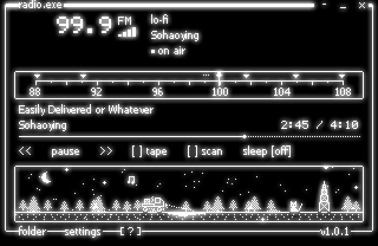
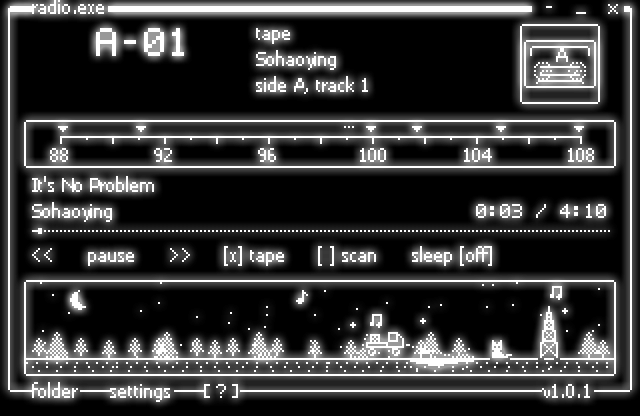
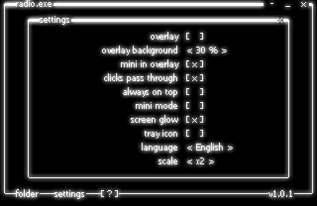
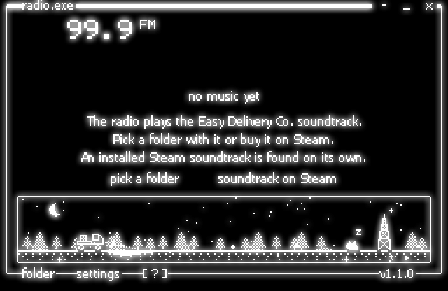

[Русский](README.md) · **English** · [website](https://edc-radio-site.vercel.app/en/)

# EDC Radio

EDC Radio is a Windows radio that plays the Easy Delivery Co. soundtrack as
radio stations, like the receiver in the truck cab. Six stations sit on the
in-game radio frequencies with the same track order, and the seventh is the
player's own. The window is drawn with the game's own fonts
and icons. The player reads them from the installed game at launch and copies
nothing to disk. On top of a game it can sit as a see-through strip that lets
clicks pass.



## Stations 88.1 to 107.9

There are seven stations on a dial from 88 to 108 MHz in 0.1 MHz steps.

- **88.1 your radio** plays files from the game's `StreamingAssets\CustomRadio`
  folder, if you put any there.
- **91.1 EasyCo radio** loops Rainless.
- **99.1 EZ News** airs in the cab only, so here you get static and a ticker.
- **99.9 lo-fi** has 9 Sohaoying tracks in 10 slots. Easily Delivered or
  Whatever plays twice, as in the game.
- **101.7 drum and bass** has 10 pr0te tracks.
- **104.9 rally** has 6 Sohaoying tracks.
- **107.9 after hours** plays Shut Down and Rainless (Hum). In the game these
  two tracks sit on no station, so here they get a frequency of their own.

A station plays like a broadcast. The position in its list counts from
1 January 2025 UTC, so a song is usually already playing when you tune in, and
two players on two computers stay within a second of each other. A station
comes in within 0.4 MHz of its frequency. The further off the needle, the
louder the static, the more the sound wavers and the more noise dots on the
screen. Jumping to the next station crackles for 0.35 seconds.

## Tape, scan, sleep, volume

- **Tape** plays the whole album in order. Side A is disc 1 with 22 tracks,
  side B is disc 2 with 6. The `<<` and `>>` buttons move between tracks. The
  track is kept until the next launch, even when files are added to the
  folder.
- **Scan** moves to the next station every 6 seconds until you touch the dial.
- **Sleep** runs 15, 30 or 60 minutes. The sound fades over the last
  10 seconds, then the player pauses.
- **Volume** moves in 5 % steps with the up and down arrows, or with the
  mouse wheel anywhere off the dial.



## Overlay on top of a game

Ctrl+Alt+O turns the window into a strip above all windows, and a second press
brings the normal window back. The Ctrl+Alt keys work while a game has focus.

- **Background** makes the black behind the lines 0, 30, 60 or 100 % opaque.
  At 0 % only the lines with a thin black edge and the glow remain, at 100 %
  the window looks as usual. The glow stays, so the lines shine right over the
  game picture.
- **Mini** shows only the frequency, station, track and time, 320 by 64 pixels
  instead of 320 by 208.
- **Clicks pass through** lets the mouse go through the strip into the game,
  and the title bar shows Ctrl+Alt+O instead of buttons. That key or the tray
  menu gives the clicks back. If another program holds the key, the title bar
  says "tray menu". If the tray icon is off as well, clicks do not pass
  through.

While the cursor is not over the strip, the background and the glow dim to
80 %, and the lines themselves stay bright.

Background, mini and clicks live in the "settings" window, laid out like the
game's settings: `[X]` toggles, `< 30 % >` steps through values. It also
holds always on top without the overlay, mini mode for the normal window,
glow, the tray icon, language and scale. Mini mode also comes on with the
M key or the `-` in the title bar.



## Steam soundtrack or your folder

The program contains no music. It takes music from three places and looks
nowhere else.

1. **The Steam soundtrack** ([app 3994280](https://store.steampowered.com/app/3994280)).
   When it is installed, the player finds it in `steamapps\music` of the Steam
   libraries listed in `libraryfolders.vdf`. The Steam path itself comes from
   the registry.
2. **A folder you pick** with the "folder" button. Subfolders are read too,
   and unreadable ones are skipped.
3. **The game's `StreamingAssets\CustomRadio` folder**, for station 88.1 only.

Without music the window offers to pick a folder or to open the soundtrack
page on Steam. Formats are FLAC, WAV, M4A, MP3 and WMA, up to 2000 files in
each folder. The window opens at once and the tracks are read in the
background. If a track exists in two formats, FLAC plays. If your folder has
songs with the same names as soundtrack tracks, the stations play the ones
from the folder that holds the most of them.

Cover art is taken from the tracks' folder. First a picture whose name holds
the station frequency, such as `cover (101.7 FM).jpg`, but not `demo`. Then
`cover`, `folder` or `front`, then the first picture in alphabetical order.
JPG, PNG and BMP up to 8 MB work. The cover is drawn in dots, 38 by 38 pixels.



## Game graphics

The player opens `EasyDeliveryCo_Data\data.unity3d` read-only and takes
5 textures plus the LanaPixel glyph table. These are the interface sheet with
frames, cursors, the truck and the radio tower, the nesFont and LanaPixel fonts
with Cyrillic, the notes and the cat from the Jump Catt minigame. On the test
computer reading them takes 0.2 seconds. If the game is missing or its files
are laid out differently, the player draws with its built-in pack, Tahoma and
its own 5 by 7 digits. The screenshots in this README show exactly that, with
no game graphics.

The built-in pack covers what the game lacks. These are pines, snowdrifts, the
moon, snowflakes, hearts and the "Zz". It also has a spare truck, cat, radio
tower and notes for when the game is missing. The pack is written out as text
in `tools/make_sprites.py`.

## The scene at the bottom

The truck drives along a night road while music plays, at 10 to 34 pixels a
second depending on the station. From 18:00 to 7:00 the headlights are on and
the moon and stars are out. The cat at the radio tower nods to the beat, jumps
when the station changes and falls asleep on pause. Click the cat and it jumps,
with a heart above it. Every 40 to 120 seconds the snow shifts between a few
flakes and a blizzard with wind.

## Download and source

Download `EdcRadio.exe` from [releases](../../releases/latest) and run it. You
need Windows 10 or 11, 64-bit. The .NET runtime is inside the exe, so there is
nothing else to install.

Settings live in `%APPDATA%\EdcRadio\settings.json`. They hold the folder,
frequency, volume, language, scale, glow, mini mode, always on top, the overlay
with its background, mini mode and clicks, the tray icon, the tape with its
track and the window position. The player saves them right after a change in
the settings and on exit. You can edit the file by hand, and `//` comments or
trailing commas do not break it. The player writes the static sound to
`%TEMP%\edc-radio-static-2.wav`, a 172 KB file, and writes it again if the
file is damaged.

## Keys and mouse

| Key | Action |
|---|---|
| ← → | frequency ±0.1 MHz |
| Ctrl + ← → | previous or next station, previous or next track on tape |
| ↑ ↓ | volume ±5 % |
| Space | pause |
| 1–7 | stations from 88.1 to 107.9 |
| T | tape |
| A | scan |
| S | sleep 15, 30, 60 minutes or off |
| G | screen glow |
| M | mini mode |
| F1 | key list in the window, two pages |
| Ctrl+Alt + Space | pause, even in a game |
| Ctrl+Alt + ← → | previous or next station, even in a game |
| Ctrl+Alt + ↑ ↓ | volume, even in a game |
| Ctrl+Alt + O | overlay |
| Ctrl+Alt + M | mini mode |
| Ctrl+Alt + H | show or hide the window |

You can drag the dial with the mouse. The wheel over the dial tunes, anywhere
else it changes the volume. In mini mode the wheel over the digits tunes, and
a click on the digits jumps to the next station. Drag any empty spot to move
the window. A click on the tray icon shows or hides the window. Its menu has
show window, pause, next station, tape, overlay, clicks pass through, always
on top and quit. Starting the exe again also brings a hidden window back.

## If something breaks

- **A damaged or deleted track.** The status line shows "could not open" with
  the file name, and the station plays the next track. If none of the station's
  tracks open, the player tries again after 10 seconds.
- **The player crashes.** It shows a message and writes a report to
  `%APPDATA%\EdcRadio\crash.log` with the date, the version, the Windows
  version and the error text. The settings are saved first.
- **settings.json is damaged.** The player starts with default settings and
  keeps the old file next to it as `settings.json.bad`.

You can report a bug in [Issues](../../issues/new/choose). The "Bug" form asks
for the version, Windows, where the music comes from and what you did. If
there is a `crash.log`, attach it.

## Building the exe

```powershell
dotnet publish src\EdcRadio\EdcRadio.csproj -c Release -r win-x64 --self-contained true -p:PublishSingleFile=true -p:IncludeNativeLibrariesForSelfExtract=true -p:EnableCompressionInSingleFile=true -o publish
```

The result is `publish\EdcRadio.exe`, 66 MB. A 270 KB file that needs the
.NET 8 Desktop Runtime comes from another command.

```powershell
dotnet publish src\EdcRadio\EdcRadio.csproj -c Release -r win-x64 -p:SelfContained=false -p:PublishSingleFile=true -o publish
```

`tools\make_sprites.py` rebuilds the sprites, `Sprites.cs` and the icon. It
needs Pillow.

```powershell
python tools\make_sprites.py
```

One command runs the tests.

```powershell
dotnet test tests\EdcRadio.Tests
```

The 42 tests cover FLAC and tag reading, duplicate handling, how tracks are
picked for stations, the broadcast clock, damaged settings, reading
`data.unity3d` from random bytes, fonts and the glow bounds. GitHub Actions
builds the exe and runs the tests on every push, and for a `v*` tag it attaches
`EdcRadio.exe` to the release.

## Files

```
src/EdcRadio/
  Program.cs     startup, a second launch raises the open window
  MainForm.cs    window, mini mode, overlay, settings, keys, tray
  Radio.cs       broadcast, tape, sleep, static and crackle
  Stations.cs    stations and the broadcast clock
  Library.cs     tracks from folders, FLAC and tags, Steam
  Scene.cs       the scene at the bottom and the weather
  Canvas.cs      320×208 canvas, frames and text
  Glow.cs        scaling, glow and transparency
  Layer.cs       the see-through window on top
  Art.cs         game graphics or the built-in pack
  Unity.cs       reading data.unity3d, LZ4 and textures
  BitmapFont.cs  pixel fonts
  Text.cs        Russian and English strings
  Settings.cs    settings.json
  Sprites.cs     sprite places, written by tools/make_sprites.py
  Assets/        built-in sprites and icon
tests/EdcRadio.Tests/  xUnit tests
tools/
  make_sprites.py  sprites, Sprites.cs and app.ico from text
site/            the project page, HTML and CSS with no build step
docs/            screenshots and GitHub texts
.github/         the GitHub Actions build and the issue forms
```

## Canvas, glow, broadcast

**Canvas.** Everything is drawn into a 320×208 frame in black and white with no
grey, then scaled by a whole number. On the test computer a frame takes 1.4 ms,
and ×3 scaling with glow adds 2.4 ms. The window refreshes about 25 times a
second.

**Glow and transparency.** White pixels are blurred twice with a 5×5 window,
and the halo rises to 60 % brightness on black only. Every pixel of the window
gets its own transparency, so in the overlay the halo stays soft on top of the
game. The lines themselves stay sharp.

**Broadcast.** Each track length comes from the FLAC header, or from the file
properties in Windows for other formats. When a track ends, the player checks
the clock again and plays whatever is on air at that moment.

## What the program does not do

- It contains no music and no game graphics. The repository holds only code
  and the built-in sprites.
- It does not search your disk for music, only Steam, the folder you pick and
  the game's CustomRadio folder.
- It changes nothing in the game or Steam files.
- It does not play the EZ News segments or the game sounds on 88.1 because
  they are not part of the soundtrack.
- The overlay does not show over games in exclusive fullscreen. It works with
  windowed and borderless games.
- Media keys work only while the window is active. The track does not show in
  the Windows volume flyout.
- It runs on Windows only.
- The build is not signed, so SmartScreen warns about an unknown publisher on
  the first run.
- It is not an official program. The game's author and the composers have
  nothing to do with it.

## Who owns what

The code is under the MIT license, see [LICENSE](LICENSE).

The music belongs to Sohaoying and pr0te. Easy Delivery Co., its fonts, icons
and names belong to its author. The player only reads them from a computer
where the game is installed.
