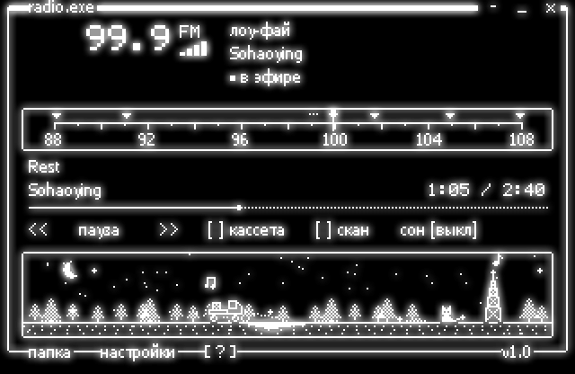
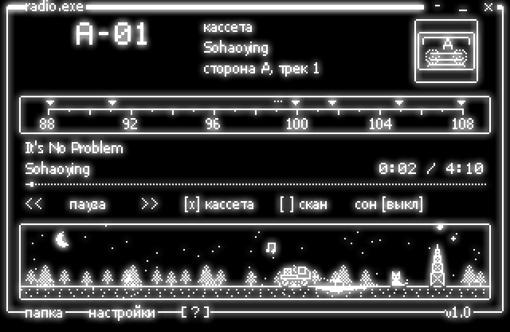
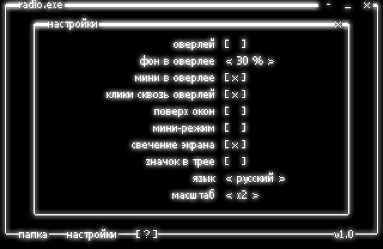
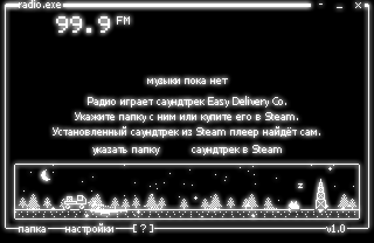

**Русский** · [English](README.en.md)

# EDC Radio

EDC Radio — радио для Windows, которое играет саундтрек Easy Delivery Co. по
станциям, как приёмник в кабине. Частоты и порядок треков те же, что у радио в
игре. Окно нарисовано шрифтами и иконками самой игры: плеер читает их из
установленной игры при запуске и ничего не копирует на диск. Поверх игры его
можно повесить прозрачной полоской, которая не мешает кликам.



## Станции 88.1–107.9

Станций семь, шкала идёт от 88 до 108 МГц с шагом 0,1 МГц.

- **88.1 своё радио** — файлы из папки `StreamingAssets\CustomRadio` игры,
  если Вы их туда положили.
- **91.1 радио ЛегКо** — Rainless по кругу.
- **99.1 EZ News** — новости выходят только в кабине, здесь шум и бегущая
  строка.
- **99.9 лоу-фай** — 9 треков Sohaoying на 10 местах, Easily Delivered or
  Whatever звучит дважды, как в игре.
- **101.7 драм-н-бейс** — 10 треков pr0te.
- **104.9 ралли** — 6 треков Sohaoying.
- **107.9 после смены** — Shut Down и Rainless (Hum). В игре эти два трека не
  стоят ни на одной станции, здесь у них своя частота.

Станция играет как эфир. Место в списке считается от 1 января 2025 года по UTC,
поэтому при включении песня обычно уже идёт, а два плеера на разных
компьютерах звучат одинаково с точностью до секунды. Станция ловится в пределах
0,4 МГц от своей частоты. Чем дальше стрелка, тем громче шум, тем сильнее
плавает звук и тем больше точек помех на экране. При переходе на соседнюю
станцию 0,35 секунды трещит эфир.

## Кассета, скан, сон, громкость

- **Кассета** — весь альбом по порядку. Сторона A — первый диск, 22 трека,
  сторона B — второй, 6 треков. Кнопки `<<` и `>>` листают треки. Номер трека
  плеер помнит до следующего запуска.
- **Скан** — плеер сам переходит на следующую станцию каждые 6 секунд, пока
  Вы не тронете шкалу.
- **Сон** — 15, 30 или 60 минут. Последние 10 секунд звук затихает, потом
  плеер встаёт на паузу.
- **Громкость** — шаг 5 %, стрелками вверх и вниз или колесом мыши вне шкалы.



## Оверлей поверх игры

Ctrl+Alt+O превращает окно в полоску поверх всех окон, второе нажатие
возвращает обычный вид. Клавиши Ctrl+Alt работают и тогда, когда фокус в игре.

- **Фон** — чёрное за линиями непрозрачно на 0, 30, 60 или 100 %. При 0 %
  видны только линии с тонкой чёрной обводкой и свечение, при 100 % окно
  обычное. Свечение остаётся, линии светятся прямо поверх картинки игры.
- **Мини** — в оверлее видны только частота, станция, трек и время, 320 на 64
  точки вместо 320 на 208.
- **Клики сквозь** — мышь проходит сквозь полоску в игру, а в заголовке
  вместо кнопок написано Ctrl+Alt+O. Вернуть клики можно этим сочетанием или
  из меню в трее. Если сочетание занято другой программой и значок в трее
  выключен, клики сквозь полоску не пропускаются.

Пока курсор не над полоской, фон и свечение приглушены до 80 %, а сами линии
остаются яркими.

Фон, мини и клики меняются в окне «настройки», как в настройках игры: `[X]`
включает, `< 30 % >` перебирает значения. Там же поверх окон без оверлея, мини-режим для
обычного окна, свечение, значок в трее, язык и масштаб. Мини-режим включается
и клавишей M или знаком `-` в заголовке.



## Саундтрек из Steam и своя папка

Музыки в программе нет. Плеер берёт её из трёх мест и больше нигде не ищет.

1. **Саундтрек из Steam** ([app 3994280](https://store.steampowered.com/app/3994280)).
   Если он установлен, плеер находит его в `steamapps\music` библиотек Steam
   из `libraryfolders.vdf`. Путь к самому Steam берётся из реестра.
2. **Папка, которую Вы укажете** кнопкой «папка». Подпапки тоже читаются,
   закрытые для чтения пропускаются.
3. **Папка `StreamingAssets\CustomRadio` игры** — только для станции 88.1.

Без музыки окно предлагает указать папку или открыть страницу саундтрека в
Steam. Форматы FLAC, WAV, M4A, MP3 и WMA, до 2000 файлов. Если трек лежит в
двух форматах, играет FLAC.

Обложку плеер ищет рядом с треками. Сначала картинку, в имени которой есть
частота станции, например `cover (101.7 FM).jpg`, но не `demo`. Потом
`cover`, `folder` или `front`, потом первую картинку по алфавиту. Подходят
JPG, PNG и BMP. На экран обложка выводится точками, 38 на 38 пикселей.



## Графика игры

Плеер открывает `EasyDeliveryCo_Data\data.unity3d` только на чтение и берёт 5
текстур и таблицу букв LanaPixel. Это лист интерфейса с рамками, курсорами,
грузовиком и радиовышкой, шрифты nesFont и LanaPixel с кириллицей, ноты и кот
из мини-игры Jump Catt. На тестовом компьютере чтение занимает 0,2 секунды.
Если игры нет или её файлы устроены иначе, плеер рисует своим паком, шрифтом
Tahoma и своими цифрами 5 на 7 точек. Скриншоты в этом README сняты именно в
таком виде, без графики игры.

Свой пак закрывает то, чего в игре нет. Это ёлки, сугробы, луна, снежинки,
сердечки и «Zz». Ещё в нём запасные грузовик, кот, радиовышка и ноты на случай,
если игры нет. Пак описан текстом в `tools/make_sprites.py`.

## Сценка внизу окна

Грузовик едет по ночной дороге, пока играет музыка. Скорость зависит от
станции, от 10 до 34 точек в секунду. Ночью с 18:00 до 7:00 горят фары, на
небе луна и звёзды. Кот у радиовышки качает головой в такт, при смене станции
подпрыгивает, на паузе засыпает. Если щёлкнуть по коту, он подпрыгнет и над
ним появится сердечко. Снег раз в 40–120 секунд меняется от редких снежинок до
метели с ветром.

## Готовый exe и исходники

Скачайте `EdcRadio.exe` из [релизов](../../releases/latest) и запустите.
Нужны Windows 10 или 11, 64 бита. Среда .NET уже внутри exe, ставить её не
нужно.

Настройки лежат в `%APPDATA%\EdcRadio\settings.json`. Там папка, частота,
громкость, язык, масштаб, свечение, мини-режим, поверх окон, оверлей с фоном,
мини-режимом и кликами, значок в трее, кассета с номером трека и место окна. Звук помех плеер
один раз пишет в `%TEMP%\edc-radio-static-2.wav`, файл весит 172 КБ.

## Клавиши и мышь

| Клавиша | Действие |
|---|---|
| ← → | частота ±0,1 МГц |
| Ctrl + ← → | соседняя станция, на кассете соседний трек |
| ↑ ↓ | громкость ±5 % |
| пробел | пауза |
| 1–7 | станции от 88.1 до 107.9 |
| T | кассета |
| A | скан |
| S | сон 15, 30, 60 минут или выкл |
| G | свечение экрана |
| M | мини-режим |
| F1 | список клавиш в окне, две страницы |
| Ctrl+Alt + пробел | пауза, даже в игре |
| Ctrl+Alt + ← → | соседняя станция, даже в игре |
| Ctrl+Alt + ↑ ↓ | громкость, даже в игре |
| Ctrl+Alt + O | оверлей |
| Ctrl+Alt + M | мини-режим |
| Ctrl+Alt + H | показать или скрыть окно |

Шкалу можно тянуть мышью. Колесо над шкалой крутит частоту, в остальном окне
меняет громкость. В мини-режиме частоту крутит колесо над цифрами, а щелчок по
цифрам включает следующую станцию. Окно двигается за любое пустое место.
Щелчок по значку в трее показывает или скрывает окно. В меню у значка показать
окно, пауза, следующая станция, кассета, оверлей, клики сквозь оверлей, поверх
окон и выход. Повторный запуск exe тоже показывает скрытое окно.

## Сборка exe

```powershell
dotnet publish src\EdcRadio\EdcRadio.csproj -c Release -r win-x64 --self-contained true -p:PublishSingleFile=true -p:IncludeNativeLibrariesForSelfExtract=true -p:EnableCompressionInSingleFile=true -o publish
```

Результат — `publish\EdcRadio.exe` на 66 МБ. Файл на 270 КБ, которому нужна
.NET 8 Desktop Runtime, собирает другая команда.

```powershell
dotnet publish src\EdcRadio\EdcRadio.csproj -c Release -r win-x64 -p:SelfContained=false -p:PublishSingleFile=true -o publish
``` Спрайты,
`Sprites.cs` и иконку пересоздаёт `tools\make_sprites.py`, ему нужен Pillow.

```powershell
python tools\make_sprites.py
```

## Файлы

```
src/EdcRadio/
  Program.cs     запуск, второй запуск поднимает открытое окно
  MainForm.cs    окно, мини-режим, оверлей, настройки, клавиши, трей
  Radio.cs       эфир, кассета, сон, шум и треск
  Stations.cs    станции и место в эфире по часам
  Library.cs     поиск треков, FLAC и теги, Steam
  Scene.cs       сценка внизу окна и погода
  Canvas.cs      холст 320×208, рамки и текст
  Glow.cs        масштаб, свечение и прозрачность
  Layer.cs       прозрачное окно поверх других
  Art.cs         графика игры или свой пак
  Unity.cs       чтение data.unity3d, LZ4 и текстуры
  BitmapFont.cs  пиксельные шрифты
  Text.cs        строки на русском и английском
  Settings.cs    settings.json
  Sprites.cs     места спрайтов, его пишет tools/make_sprites.py
  Assets/        свои спрайты и иконка
tools/
  make_sprites.py  спрайты, Sprites.cs и app.ico из текста
docs/            скриншоты и тексты для GitHub
```

## Холст, свечение, эфир

**Холст.** Всё рисуется в кадр 320×208 точек, чёрное и белое без полутонов,
потом увеличивается в целое число раз. На тестовом компьютере кадр готовится
за 1,4 мс, масштаб ×3 со свечением добавляет 2,4 мс. Окно обновляется около
25 раз в секунду.

**Свечение и прозрачность.** Белые точки дважды размываются окном 5×5, ореол
поднимается до 60 % яркости и ложится только на чёрное. Каждая точка окна
получает свою прозрачность, поэтому в оверлее ореол остаётся мягким и поверх
игры. Сами линии остаются резкими.

**Эфир.** Длина каждого трека берётся из заголовка FLAC, для других форматов
из свойств файла в Windows. Когда трек кончается, плеер заново смотрит на часы
и включает то, что идёт в эфире сейчас.

## Чего программа не делает

- Не содержит музыки и графики игры. В репозитории только код и свои спрайты.
- Не ищет музыку по диску сама, только в Steam, в выбранной папке и в
  CustomRadio игры.
- Ничего не меняет в файлах игры и Steam.
- Не играет новости EZ News и звуки игры с 88.1, их нет в саундтреке.
- Оверлей не виден поверх игр в эксклюзивном полноэкранном режиме. Он работает
  с играми в окне и в окне без рамки.
- Медиаклавиши работают, только когда окно активно. В системном окне
  громкости Windows трек не показывается.
- Работает только в Windows.
- Сборка не подписана сертификатом, поэтому SmartScreen при первом запуске
  предупредит о неизвестном издателе.
- Это не официальная программа. Автор игры и композиторы к ней отношения не
  имеют.

## Чьё здесь что

Код под лицензией MIT, см. [LICENSE](LICENSE).

Музыка принадлежит Sohaoying и pr0te. Игра Easy Delivery Co., её шрифты,
иконки и названия принадлежат её автору. Плеер только читает их с компьютера,
где игра установлена.
